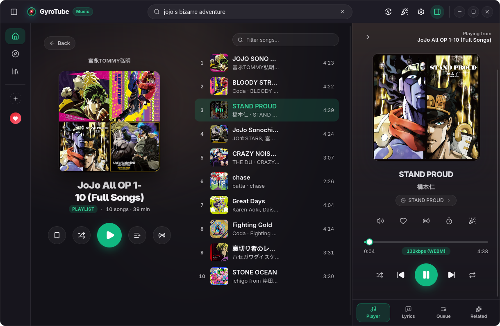
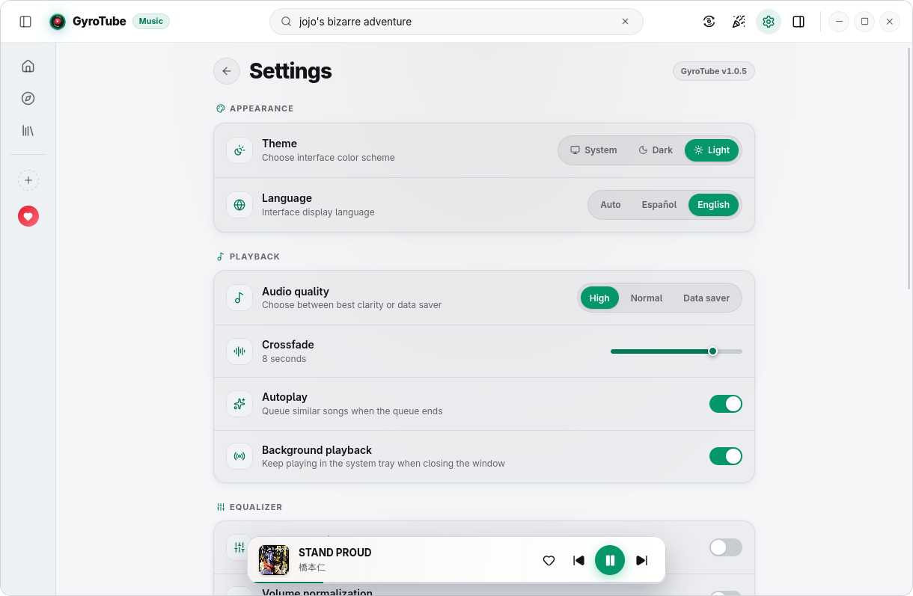

<p align="center">
  
</p>

<h1 align="center">GyroTube</h1>

<p align="center">
  <strong>Your music, without distractions, on every device.</strong><br />
  A native cross-platform YouTube Music client for <strong>Linux, Windows, macOS, and Android</strong>.<br />
  Fast, privacy-first, featuring synced karaoke lyrics, offline downloads, and real-time collaborative listening.
</p>

<p align="center">
  
  
  
  
</p>

<p align="center">
  <a href="#-key-features">Features</a> •
  <a href="#-gallery">Gallery</a> •
  <a href="#-keyboard-shortcuts">Shortcuts</a> •
  <a href="#-build--documentation">Build & Docs</a> •
  <a href="#-author--license">Author</a>
</p>

<p align="center">
  
</p>

---

## ✨ Key Features

### ⚡ Instant, Gapless, High-Fidelity Audio
- **Pure-Rust Dual-Deck Engine**: progressive chunked streaming with predictive next-track preloading and a smart **1 GiB** LRU disk cache.
- **Crossfade & 5-Band Equalizer**: smooth configurable transitions (`0–10 s`), EQ presets, and real-time volume normalization.
- **Official Song ↔ Video Switch**: jump seamlessly between the studio track and its official music video at the exact same timestamp.
- **Adaptive Audio Quality**: pick *Low*, *Normal*, or *High* to match your connection.

### 🎤 Synced Lyrics, Party Mode & Lyrics Cards
- **Karaoke-Grade Lyrics**: prioritizes synced line-by-line lyrics (YouTube Music + LRCLIB) with silky 60 FPS scrolling and dynamic cover-art ambient lighting.
- **Fullscreen Party Mode**: turn any monitor or TV into an immersive listening display with large artwork, live lyrics, and up-next queue.
- **Shareable Lyrics Cards**: pick 1 to 5 lines from any track and export high-DPI PNG cards (`4:5` or `1:1`) in 6 themes ready to share anywhere.

### 🌀 SPIN Mode — Collaborative Listening
- **LAN Jukebox (Local Wi-Fi)**: start a room and display a QR code—guests scan from any phone browser with zero app installs to see what's playing, search tracks, and add to the queue.
- **App-to-App Remote Sync (P2P)**: listen together across different networks over **Iroh QUIC** with a shareable `GYRO-...` invite code, synced up-next queue, and optional remote controls.

### 🎧 Your Library, Offline & Private
- **Full Offline Downloads**: save playlists and Favorites with audio, cover art, and synced lyrics for uninterrupted offline playback.
- **Smart Local Playlists**: customize name, icon, color, or cover; pin up to 4 playlists to the sidebar; use **Enhance / Smart Shuffle (`✨`)** for instant radio recommendations, with duplicate track detection.
- **Zero-Account Privacy**: date-grouped play history (*Today, Yesterday, This Week, Earlier*), hide tracks, listening stats, unified search, and **local JSON backup/restore**—no sign-in or tracking required.

### 📱 Truly Native Across Desktop & Mobile
- **Desktop Installers**: native packages for Linux (`.AppImage`, `.rpm`, `.deb`), Windows (`.msi`, `.exe`), and macOS (`.dmg`) with system tray controls, background playback, and keyboard shortcuts.
- **Native Android Experience**: foreground playback service with lock-screen `MediaSession` controls, hardware volume integration, touch-friendly bottom sheets, and `gyrotube://spin/...` deep links.
- **Adaptive Themes & Bilingual UI**: **Dark**, **Light**, and **System** themes, plus full **English** and **Spanish** support across the app, desktop tray, and SPIN guest web UI.

---

## 🖼️ Gallery

### Dark Mode & Light Mode
<table>
  <tr>
    <td width="50%" align="center">
      <br />
      <sub><strong>Home — Dark Mode</strong> (Obsidian Vinyl + Jade Emerald)</sub>
    </td>
    <td width="50%" align="center">
      <br />
      <sub><strong>Home — Light Mode</strong> (High-contrast Pearl Jade)</sub>
    </td>
  </tr>
  <tr>
    <td width="50%" align="center">
      <br />
      <sub><strong>Dedicated Search — Dark Mode</strong></sub>
    </td>
    <td width="50%" align="center">
      <br />
      <sub><strong>Dedicated Search — Light Mode</strong></sub>
    </td>
  </tr>
</table>

### Party Mode, SPIN Mode, Playlists & Settings
<table>
  <tr>
    <td width="50%" align="center">
      <br />
      <sub><strong>Party Mode</strong> — Synced lyrics & dynamic ambient lighting</sub>
    </td>
    <td width="50%" align="center">
      <br />
      <sub><strong>SPIN Mode</strong> — Wi-Fi QR Jukebox & App-to-App P2P rooms</sub>
    </td>
  </tr>
  <tr>
    <td width="50%" align="center">
      <br />
      <sub><strong>Playlists & Library</strong> — Offline downloads, sorting & Smart Shuffle</sub>
    </td>
    <td width="50%" align="center">
      <br />
      <sub><strong>Settings</strong> — 5-band EQ, audio quality, cache & JSON backups</sub>
    </td>
  </tr>
</table>

---

## ⌨️ Keyboard Shortcuts

| Shortcut | Action |
| :--- | :--- |
| `Ctrl+K` / `Cmd+K` | Focus search |
| `Space` | Play / Pause |
| `←` / `→` | Seek backward / forward 5 seconds |
| `Shift+←` / `Shift+→` | Previous / Next track |
| `M` | Mute / Unmute |

---

## 🛠️ Build & Documentation

### macOS Installation Note
Pre-built macOS `.dmg` releases are ad-hoc signed and not notarized with a paid Apple Developer account. If macOS Gatekeeper reports that **GyroTube is damaged and can't be opened**, drag **GyroTube.app** to **Applications**, then run in Terminal:

```bash
xattr -cr /Applications/GyroTube.app
```

### Build from Source

```bash
# Desktop (Linux .AppImage/.rpm/.deb, Windows .msi/.exe, macOS .dmg)
./scripts/build-desktop.sh

# Android aarch64 APK (signed release -> output/android/gyrotube-android-release.apk)
./scripts/build-android.sh
```

### Technical Documentation
- **Build Guide**: [English](docs/BUILDING.en.md) · [Español](docs/BUILDING.es.md)
- **Architecture & Design**: [English](docs/DESIGN.en.md) · [Español](docs/DESIGN.es.md)

### Workspace Overview
- `crates/gyrotube-core`: shared pure-Rust core (native InnerTube client, hardened loopback HTTP `Range` streamer, 1 GiB LRU disk cache, synced lyrics pipeline, atomic JSON persistence, and SPIN LAN/P2P).
- `apps/tauri`: cross-platform **Tauri v2 + Svelte 5 + Tailwind CSS v4** app and native Android templates (`apps/tauri/android-templates`).

---

## 👤 Author & License

Created and maintained by **[PinedaMB](https://github.com/PinedaMB)**.

Released under the **[MIT License](LICENSE)**.
