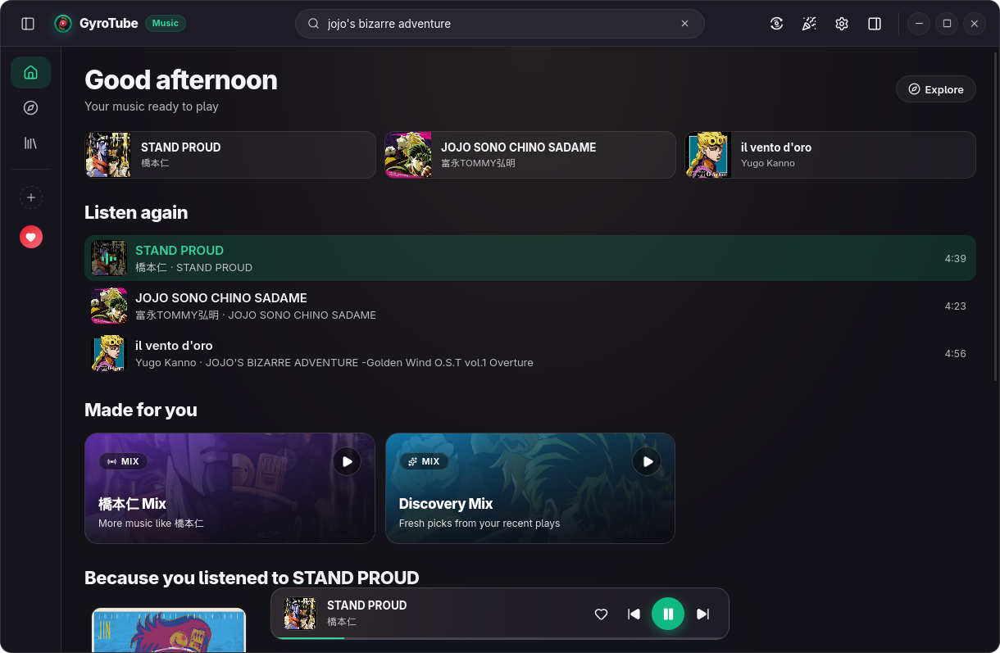
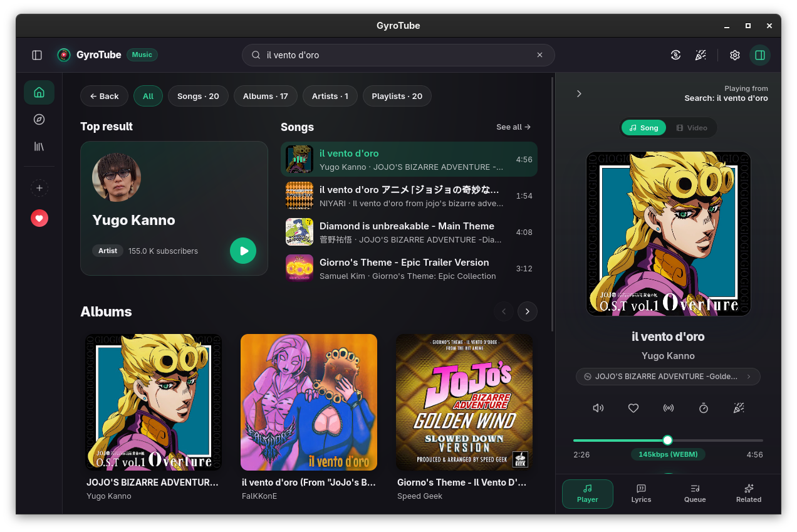
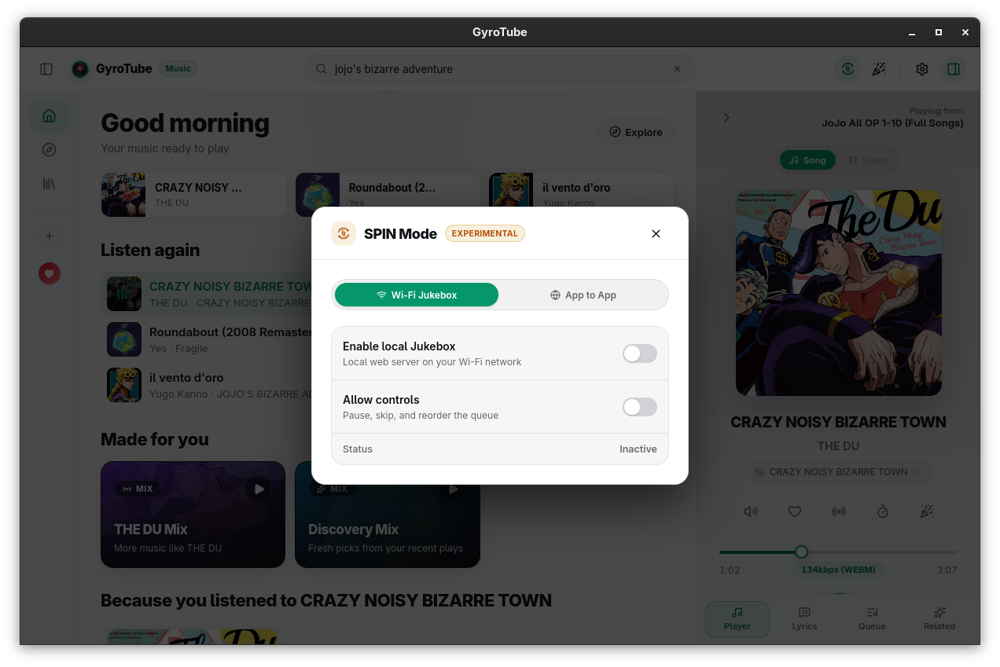

<p align="center">
  
</p>

<h1 align="center">Gyro</h1>

<p align="center">
  <strong>Your music, without distractions, on every device.</strong><br />
  A native cross-platform YouTube Music client for <strong>Linux, Windows, macOS, and Android</strong>.<br />
  Fast, privacy-first, featuring synced karaoke lyrics, offline downloads, and real-time collaborative listening.
</p>

<p align="center">
  
  
  
</p>

<p align="center">
  <a href="#-what-gyro-can-do">Features</a> •
  <a href="#-gallery">Gallery</a> •
  <a href="#-keyboard-shortcuts">Shortcuts</a> •
  <a href="#-build--documentation">Build & Docs</a> •
  <a href="#-author--license">Author</a>
</p>

<p align="center">
  
</p>

---

## ✨ What Gyro Can Do

Gyro is built for listening to music without ads, accounts, or clutter—giving you fast playback, rich lyrics, offline libraries, and shared listening sessions across all your devices.

### 🎧 Seamless Audio Playback
- **Instant & Smooth Listening**: plays music immediately with preloaded transitions, configurable crossfade (`0–10 s`), and smart local caching for replays.
- **Built-In Sound Tuning**: shape your sound with a 5-band equalizer, ready-made presets, volume normalization, and selectable audio quality (*Low*, *Normal*, *High*).
- **Skip Non-Music Parts**: optional SponsorBlock support automatically skips non-music intros, skits, and outros.

### 🎤 Live Karaoke Lyrics & Party Mode
- **Synced Word-by-Word Lyrics**: follow every line in real time, switch between lyric sources, fine-tune timing sync, and customize text size and alignment.
- **Translation & Romanization**: read lyrics translated into English or Spanish, or view romanized pronunciation for Korean, Japanese, Cyrillic, and Greek tracks.
- **Party Mode & Shareable Lyrics Cards**: turn any screen into a fullscreen karaoke display with dynamic cover-art lighting, or export favorite lines as ready-to-share PNG cards.

### 🌀 SPIN Mode — Listen Together
- **Local Wi-Fi Jukebox**: open a room and show a QR code so anyone nearby can scan from their phone browser—no app needed—to browse and add songs to your queue.
- **Remote Synced Rooms**: listen in sync with friends on other devices using a simple invite code, shared queue, and optional remote playback controls.

### 📚 Private Library & Offline Mode
- **Full Offline Downloads**: save Favorites and playlists—including audio, artwork, and lyrics—to listen anywhere without an internet connection.
- **Local Playlists & Spotify Import**: create custom playlists, pin your favorites to the sidebar, discover similar tracks with Smart Shuffle, and import playlists from a Spotify link or CSV file.
- **No Account Required**: keep your listening history, stats, hidden tracks, and local backups entirely on your device, with optional opt-in support for Discord Rich Presence, ListenBrainz, and Last.fm.

### 📱 Made for Desktop & Mobile
- **Cross-Platform**: available for Linux, Windows, macOS, and Android, with background playback, system media controls, and keyboard shortcuts.
- **Themes & Languages**: switch between **Dark**, **Light**, and **System** modes across 7 color palettes (*Gyro, AMOLED, Catppuccin, Nord, Naomi Bloom, Tokyo Night, Gruvbox*), with full **English** and **Spanish** support.

---

## 🖼️ Gallery

### Dark Mode & Light Mode
<table>
  <tr>
    <td width="50%" align="center">
      <br />
      <sub><strong>Home — Dark Mode</strong> (Obsidian Vinyl + Jade Emerald)</sub>
    </td>
    <td width="50%" align="center">
      <br />
      <sub><strong>Home — Light Mode</strong> (High-contrast Pearl Jade)</sub>
    </td>
  </tr>
  <tr>
    <td width="50%" align="center">
      <br />
      <sub><strong>Dedicated Search — Dark Mode</strong></sub>
    </td>
    <td width="50%" align="center">
      <br />
      <sub><strong>Dedicated Search — Light Mode</strong></sub>
    </td>
  </tr>
</table>

### Party Mode, SPIN Mode, Playlists & Settings
<table>
  <tr>
    <td width="50%" align="center">
      <br />
      <sub><strong>Party Mode</strong> — Synced lyrics & dynamic ambient lighting</sub>
    </td>
    <td width="50%" align="center">
      <br />
      <sub><strong>SPIN Mode</strong> — Wi-Fi QR Jukebox & App-to-App P2P rooms</sub>
    </td>
  </tr>
  <tr>
    <td width="50%" align="center">
      <br />
      <sub><strong>Playlists & Library</strong> — Offline downloads, sorting & Smart Shuffle</sub>
    </td>
    <td width="50%" align="center">
      <br />
      <sub><strong>Settings</strong> — 5-band EQ, audio quality, cache & JSON backups</sub>
    </td>
  </tr>
</table>

---

## ⌨️ Keyboard Shortcuts

| Shortcut | Action |
| :--- | :--- |
| `Ctrl+K` / `Cmd+K` | Focus search |
| `Space` | Play / Pause |
| `←` / `→` | Seek backward / forward 5 seconds |
| `Shift+←` / `Shift+→` | Previous / Next track |
| `M` | Mute / Unmute |

---

## 🛠️ Build & Documentation

### macOS Installation Note
Pre-built macOS `.dmg` releases are ad-hoc signed and not notarized with a paid Apple Developer account. If macOS Gatekeeper reports that **GyroTube is damaged and can't be opened**, drag **GyroTube.app** to **Applications**, then run in Terminal:

```bash
xattr -cr /Applications/GyroTube.app
```

### Build from Source

```bash
# Desktop (Linux .AppImage/.rpm/.deb, Windows .msi/.exe, macOS .dmg)
./scripts/build-desktop.sh

# Android aarch64 APK (signed release -> output/android/gyrotube-android-release.apk)
./scripts/build-android.sh
```

### Technical Documentation
- **Build Guide**: [English](docs/BUILDING.en.md) · [Español](docs/BUILDING.es.md)
- **Architecture & Design**: [English](docs/DESIGN.en.md) · [Español](docs/DESIGN.es.md)

---

## 👤 Author & License

Created and maintained by **[PinedaMB](https://github.com/PinedaMB)**.

Released under the **[MIT License](LICENSE)**.
